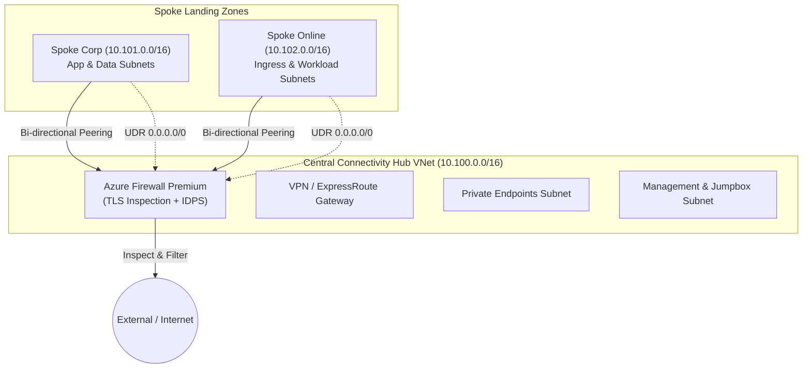

# 🔐 Azure Enterprise Landing Zones (Terraform CAF)

[](https://github.com/RisikeshSharma/azure-enterprise-landing-zones/actions)
[](#-security--compliance)
[](https://www.terraform.io)

Production-grade Terraform framework implementing the **Microsoft Cloud Adoption Framework (CAF)** Enterprise-Scale Architecture. Built around a hardened **Hub-and-Spoke network topology**, automated micro-segmentation, centralized egress inspection with **Azure Firewall Premium**, and zero-trust security controls.

---

## 🏛️ Architecture Overview



---

## ⚡ Key Terraform Engineering Patterns

- **`for_each` Iteration**: Dynamic generation of Hub and Spoke subnets, virtual network peerings, route tables, and Network Security Groups without hardcoded duplication.
- **`dynamic` Blocks**:
  - `dynamic "security_rule"`: Constructs fine-grained zero-trust NSG ingress/egress rules from typed object lists.
  - `dynamic "ip_configuration"`: Scalable IP configurations for Azure Firewall multi-pip environments.
  - `dynamic "delegation"`: Conditional subnet service delegations.
- **Conditional Iteration**:
  - `for_each = { for k, v in var.spoke_vnets : k => v if v.enable_hub_peering }` prevents unintended peering loops.
- **Egress Isolation (Zero-Trust UDR)**:
  - Custom User-Defined Routes force `0.0.0.0/0` outbound traffic through Azure Firewall Virtual Appliance private IP.

---

## 🚀 Quickstart

### Prerequisites
- [Terraform CLI >= 1.5.0](https://developer.hashicorp.com/terraform/downloads)
- [Azure CLI (az)](https://learn.microsoft.com/en-us/cli/azure/install-azure-cli) authenticated with `az login`

```bash
# 1. Clone repository
git clone https://github.com/RisikeshSharma/azure-enterprise-landing-zones.git
cd azure-enterprise-landing-zones

# 2. Copy and configure variables
cp terraform.tfvars.example terraform.tfvars

# 3. Initialize and validate
terraform init
terraform validate

# 4. Plan and review
terraform plan -out=tfplan.binary

# 5. Apply
terraform apply tfplan.binary
```

---

## 🛡️ Security & Compliance

Automated GitHub Actions CI executes:
- **Checkov**: CIS Microsoft Azure Foundations Benchmark v2.0 verification.
- **Trivy**: Infrastructure as Code misconfiguration and vulnerability scanner.
- **Terraform Format & Linting**: Enforces HCL consistency across modules.

---

## 👤 Author

**Rishikesh Sharma**  
Senior DevSecOps Engineer & Cloud Solutions Architect  
[GitHub Profile](https://github.com/RisikeshSharma) · [LinkedIn](https://linkedin.com)
