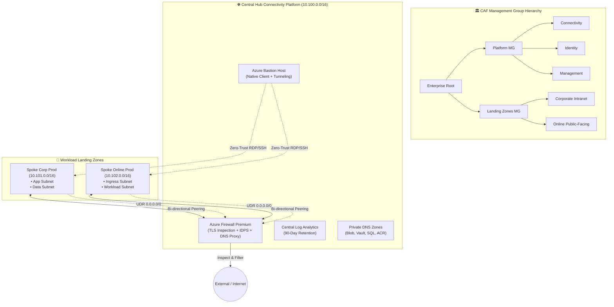

# 🔐 Azure Enterprise Landing Zones (Terraform CAF)

[](https://github.com/RisikeshSharma/azure-enterprise-landing-zones/actions)
[](#-security--compliance)
[](https://www.terraform.io)

Production-grade, modular Terraform framework implementing the **Microsoft Cloud Adoption Framework (CAF)** Enterprise-Scale Architecture. Built around a hardened **Hub-and-Spoke network topology**, automated micro-segmentation, centralized egress inspection with **Azure Firewall Premium**, **Azure Bastion**, **Private DNS Zones**, and zero-trust security controls.

---

## 🏛️ Enterprise Hub & Spoke Topology



---

## ⚡ Key Terraform Engineering Patterns

- **Modular Architecture (`modules/`)**:
  - [`modules/management_groups`](./modules/management_groups): Provisions the hierarchical CAF Management Group tree using `for_each`.
  - [`modules/hub_connectivity`](./modules/hub_connectivity): Central Connectivity Hub VNet, Azure Firewall Premium with TLS inspection policy, Bastion Host, and Private DNS Zones.
  - [`modules/spoke_workload`](./modules/spoke_workload): Reusable workload landing zone module provisioning subnets, NSGs, UDRs, DNS links, and bi-directional peerings.
  - [`modules/governance_policy`](./modules/governance_policy): Automated assignment of the CIS Microsoft Azure Foundations Benchmark v2.0 initiative.
- **`for_each` Iteration**:
  - Dynamically iterates over subnets, spoke landing zones, and Private DNS Zones without code duplication.
- **`dynamic` Blocks**:
  - `dynamic "security_rule"`: Constructs fine-grained zero-trust NSG rules.
  - `dynamic "delegation"`: Conditionally applies subnet service delegations.
- **Conditional Expressions**:
  - Clean feature flags (`deploy_management_groups`, `deploy_azure_bastion`, `enable_cis_policy_initiative`).
- **Egress Isolation (Zero-Trust UDR)**:
  - Custom User-Defined Routes force `0.0.0.0/0` outbound traffic through Azure Firewall Virtual Appliance private IP.

---

## 🚀 Quickstart

### Prerequisites
- [Terraform CLI >= 1.5.0](https://developer.hashicorp.com/terraform/downloads)
- [Azure CLI (az)](https://learn.microsoft.com/en-us/cli/azure/install-azure-cli) authenticated with `az login`

```bash
# 1. Clone repository
git clone https://github.com/RisikeshSharma/azure-enterprise-landing-zones.git
cd azure-enterprise-landing-zones

# 2. Copy and configure variables
cp terraform.tfvars.example terraform.tfvars

# 3. Initialize and validate
terraform init
terraform validate

# 4. Plan and review
terraform plan -out=tfplan.binary

# 5. Apply
terraform apply tfplan.binary
```

---

## 🛡️ Security & Compliance

Automated GitHub Actions CI executes:
- **Checkov**: CIS Microsoft Azure Foundations Benchmark v2.0 verification.
- **Trivy**: Infrastructure as Code misconfiguration and vulnerability scanner.
- **Terraform Format & Linting**: Enforces HCL consistency across all modules.

---

## 👤 Author

**Rishikesh Sharma**  
Senior DevSecOps Engineer & Cloud Solutions Architect  
[GitHub Profile](https://github.com/RisikeshSharma) · [LinkedIn](https://www.linkedin.com/in/rishikesh-sharma-devsecops)
